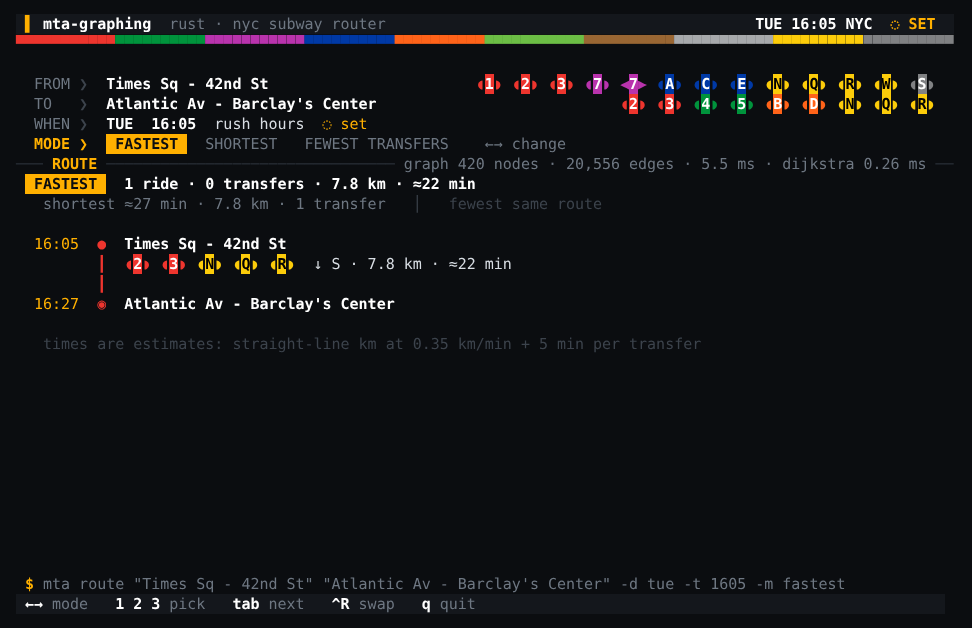
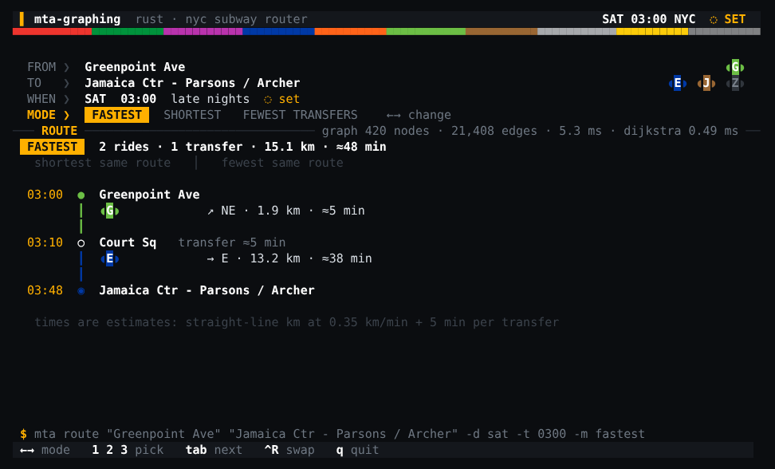

# MTA Network Graphing (Rust)

Find the best NYC subway route from one station to another for a given time and day with a sick UI.

This is a Rust port of my original MTA Graphing project back in undergrad where I wrote this in Java.
Without the UI though. Wanted to port this to Rust because I've been learning it a while back and I
friggin LOVE Rust. I didn't know what to build with Rust though, so here's sumn.
Here, it has no dependencies (standard library only), so it builds offline on **Windows, macOS and Linux**.




## How to Use

You need Rust 1.74 or newer (`rustup update`).

```powershell
cargo run --release             # opens the UI
cargo install --path .          # optional: puts `mta` on your PATH
```

On Windows, run it in **Windows Terminal**. PowerShell and cmd work inside it, and colors and Unicode
render correctly there. The legacy console host on Windows 10 works too.

## How to Navigate the UI

```
mta                                  # live NYC clock
mta --day sat --time 2300            # start at a fixed time
```

| Field | Keys |
|---|---|
| **FROM / TO** | type to search (`times sq`, `atlantic`, `86 6`: a line label narrows it), `↑↓` pick, `Enter` choose, `Esc` cancel |
| **WHEN** | `←→` ±15 min, `+`/`-` ±1 h, `[` `]` previous/next day, type `2300` or `sat`, `n` back to the live clock |
| **MODE** | `←→` or `1` `2` `3`: **fastest**, **shortest** (distance), **fewest transfers** |
| anywhere | `Tab`/`Shift+Tab` move between fields, `Ctrl+R` swap stations, `Ctrl+G` bullet style, `PgUp`/`PgDn` scroll, `Ctrl+C` quit |

Station bullets are colored when the service stops there at the chosen time and **grey when it
doesn't**. Late nights, the B and W disappear on weekends, the Z runs only at rush hour, and so on.
The bottom line shows the equivalent CLI command.

### Bullet styles

| style | local | express | when to use |
|---|---|---|---|
| `unicode` (default) | `◖6◗` | `◀6▶` | any modern font |
| `nerd` | rounded powerline caps | pointed powerline caps | best looking; needs a [Nerd Font](https://www.nerdfonts.com/) such as *CaskaydiaCove Nerd Font* set as the terminal font |
| `ascii` | `(6)` | `<6>` | the original Java output format |

Switch with `Ctrl+G`, `--glyphs nerd`, or set it permanently with the `MTA_GLYPHS=nerd` environment variable.

## Command line

```text
mta route <FROM> <TO> [-d DAY] [-t HHMM] [-m fastest|shortest|fewest]
mta stations [QUERY]          list or search stations, with today's bullets
mta classic                   the original program's prompts and "Shortest Path / Shortest Walk Path" output
mta check                     how every station's service notes were parsed (debugging the data)
```

```text
$ mta route "pelham bay park" "grand central" -d tue -t 0800

 08:00  ●  Pelham Bay Park
        ┃  ◀6▶            ↙ SW · 16.8 km · ≈48 min
        ┃
 08:48  ◉  Grand Central - 42nd St

 1 ride · 0 transfers · 16.8 km · ≈48 min
```

When a name matches several stations (there are five *86th St*), the CLI lists them with their
lines. Pass the full label, e.g. `"86th St (4 5 6)"`.

## Assumptions

* **Time periods** follow the MTA's definitions. Rush hours are 6:30–9:30 AM and 3:30–8 PM on
  weekdays; evenings run 8 PM to midnight; late nights run midnight to 6:30 AM. Plain "weekdays"
  service is taken to end at 9 PM. The Java version counted 8 PM–7 AM as "night".
* **Travel time** keeps the original estimate of 0.35 km of straight-line distance per minute.
  Each transfer adds 5 minutes, and *fastest* mode uses that penalty.
* **"Now"** is New York time, computed from your system clock with US daylight-saving rules,
  wherever your computer is.
* The dataset is the NYC Open Data subway-stations CSV from the original repo and predates some
  service changes. For example, Cortlandt St (1) is still marked *temporarily closed*. Point
  `--data` at a newer copy with the same columns to update it.
* Like the original, an edge means "one train serves both stations" without the order of stops.
  Each leg is therefore one ride, and its distance is straight-line.

---
Original Java version and data model by me [here](https://github.com/PrideInt/mta-graphing).
